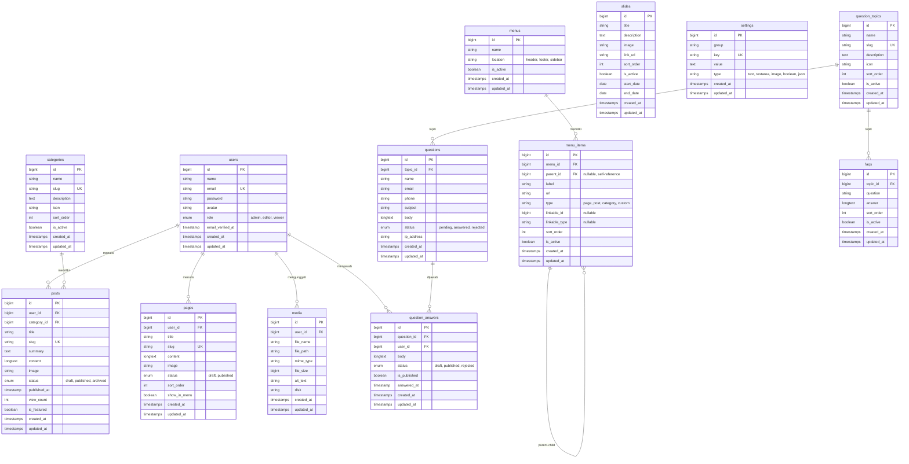
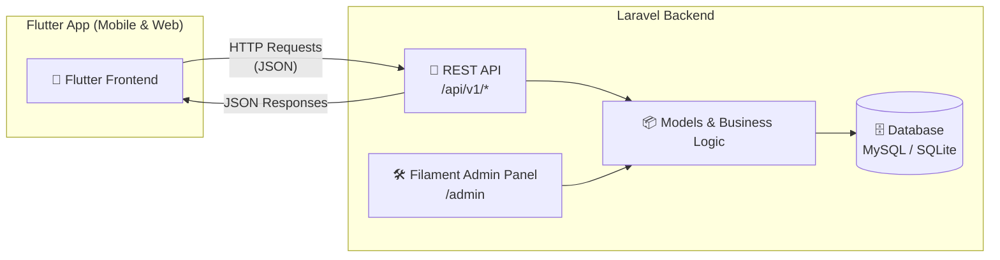

# 📋 Rencana Aksi: Aplikasi CMS & Pertanyaan Masyarakat

> Aplikasi Laravel 13 + Filament v5.11 sebagai backend (Admin Panel + REST API) untuk mengelola konten profil instansi dan menerima pertanyaan dari masyarakat. Frontend publik akan dibangun terpisah menggunakan **Flutter**.

---

## 🗂️ Entity Relationship Diagram (ERD)

---

## 🏛️ Arsitektur Sistem (API-First)

---

## 🏗️ Arsitektur Modul

### Modul 1: CMS (Content Management System)

| Fitur | Status | Deskripsi |
|-------|--------|-----------|
| **Manajemen Kategori** | ✅ Selesai | CRUD kategori artikel, slug otomatis, sort order, icon, active toggle |
| **Manajemen Post/Artikel** | ✅ Selesai | CRUD artikel, TipTap/RichEditor, summary, image upload, status (draft/published/archived), headline toggle |
| **Manajemen Halaman Statis** | ✅ Selesai | CRUD halaman statis profil instansi ("Tentang Kami", "Visi Misi", dll), slug otomatis |
| **Galeri Media** | ✅ Selesai | Upload berkas & gambar ke storage publik, preview dan metadata file |
| **Menu Navigasi** | ✅ Selesai | Menu header/footer/sidebar dengan nested/repeater item menu |
| **Slide Banner** | ✅ Selesai | Banner promosi beranda dengan jadwal tayang otomatis (start_date - end_date) |
| **Pengaturan Situs** | ✅ Selesai | Key-value settings untuk nama instansi, logo, kontak, alamat, medsos |
| **Manajemen Pengguna** | ✅ Selesai | Kelola akun admin & editor, role enum (Admin, Editor, Viewer), avatar |

### Modul 2: Layanan & Pertanyaan Masyarakat

| Fitur | Status | Deskripsi |
|-------|--------|-----------|
| **Topik Pertanyaan** | ✅ Selesai | Pengelompokan topik pertanyaan dan FAQ (Pelayanan, Administrasi, dll) |
| **Pertanyaan Warga** | ✅ Selesai | Data pertanyaan warga dari API Flutter, filter status (pending/answered/rejected) |
| **Jawaban Resmi** | ✅ Selesai | Relation manager tanggapan dari admin dengan Enum `AnswerStatus` (draft/published/rejected), otomatis ubah status pertanyaan ke `answered` |
| **Notifikasi Email** | ✅ Selesai | Notifikasi otomatis via email (`QuestionAnsweredNotification`) saat tanggapan diterbitkan |
| **FAQ (Tanya Jawab)** | ✅ Selesai | Kumpulan tanya-jawab publik berdasarkan topik, RichEditor answer |

---

## 📦 Status Tahapan Implementasi

### Fase 1: Fondasi & Konfigurasi ✅
- [x] Install Laravel 13 + Filament v5.11
- [x] Konfigurasi database (`.env`)
- [x] Setup Filament Admin Panel (Branding, Indigo Color Theme, Collapsible Sidebar, Navigation Groups)
- [x] Konfigurasi role & permission pada model User (`UserRole` Enum, `FilamentUser` interface)
- [x] Buat migration untuk tabel `settings`
- [x] Buat `SettingResource` di Filament

### Fase 2: Modul CMS ✅
- [x] **Kategori**: Model, Migration, Factory, `CategoryResource` (auto-slug, badge counts)
- [x] **Post/Artikel**: Model, Migration, Factory, `PostResource` (RichEditor, auto-slug, featured, summary)
- [x] **Halaman Statis**: Model, Migration, Factory, `PageResource` (RichEditor, status, show_in_menu)
- [x] **Galeri Media**: Model, Migration, Factory, `MediaResource` (public storage upload)
- [x] **Menu & Menu Items**: Model, Migration, Factory, `MenuResource` (Repeater items, location header/footer/sidebar)
- [x] **Slide Banner**: Model, Migration, Factory, `SlideResource` (jadwal tayang, active scope)

### Fase 3: Modul Pertanyaan Masyarakat ✅
- [x] **Topik Pertanyaan**: Model, Migration, Factory, `QuestionTopicResource`
- [x] **Pertanyaan**: Model, Migration, Factory, `QuestionResource` (filter status, penanya, topik)
- [x] **Jawaban Pertanyaan**: Model, Migration, Factory, `AnswersRelationManager` (Enum `AnswerStatus`, auto-update status pertanyaan)
- [x] **Notifikasi Email**: `QuestionAnsweredNotification` untuk mengirim email otomatis ke penanya
- [x] **FAQ**: Model, Migration, Factory, `FaqResource` (filter topik, RichEditor)

### Fase 4: REST API untuk Flutter ✅
- [x] Install & konfigurasi Laravel Sanctum
- [x] CORS configuration (`config/cors.php`) untuk akses Flutter Mobile & Web
- [x] API Resource classes (`PostResource`, `PageResource`, `CategoryResource`, `SlideResource`, `MenuResource`, `QuestionResource`, dll)
- [x] Privacy masking nama penanya pada endpoint publik
- [x] Rate limiting pada endpoint submit pertanyaan (`throttle:10,1`)
- [x] **API Endpoints (`/api/v1/`):**
  - `GET /api/v1/posts` — Daftar artikel (filter kategori, pencarian, paginasi)
  - `GET /api/v1/posts/featured` — Artikel unggulan (headline)
  - `GET /api/v1/posts/{slug}` — Detail artikel (otomatis menambah counter view)
  - `GET /api/v1/pages/{slug}` — Konten halaman statis
  - `GET /api/v1/categories` — Kategori aktif beserta jumlah artikel
  - `GET /api/v1/slides` — Banner slide aktif yang sedang tayang
  - `GET /api/v1/menus/{location}` — Menu navigasi bersarang (header/footer/sidebar)
  - `GET /api/v1/settings` — Pengaturan situs publik (nama instansi, kontak, dll)
  - `GET /api/v1/question-topics` — Daftar topik pertanyaan dan FAQ
  - `GET /api/v1/questions` — Arsip publik pertanyaan yang telah dijawab
  - `POST /api/v1/questions` — Formulir kirim pertanyaan dari masyarakat
  - `GET /api/v1/faqs` — Daftar FAQ aktif per topik

### Fase 5: Polish, Dashboard & Testing ✅
- [x] Dashboard widget `StatsOverviewWidget` (statistik pertanyaan masuk, terjawab, artikel terbit, slide aktif)
- [x] Dashboard widget `LatestQuestionsWidget` (tabel 5 pertanyaan terbaru dengan tombol respon langsung)
- [x] Dashboard widget `LatestPostsWidget` (tabel 5 artikel terbaru beserta statistik views)
- [x] Model Factories untuk semua 12 model
- [x] Seeder komprehensif (`DatabaseSeeder`) dengan akun admin default dan data sampel
- [x] Automated Feature Tests (`ApiFeatureTest` — 11 test case, 65 assertions lolos 100%)
- [x] Formatting kode sesuai standar Laravel menggunakan Laravel Pint

---

## 🔑 Kredensial Default Admin Panel

- **URL Admin**: `http://localhost:8000/admin`
- **Email**: `admin@example.com`
- **Password**: `password`
- **Role**: Administrator
